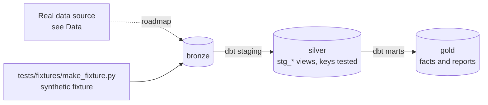

# Health Claims & Pre-Authorisation Warehouse

[](https://github.com/Saigwe/health-claims-warehouse/actions/workflows/ci.yml)

> A Kimball warehouse for health-insurance claims and pre-authorisations: turnaround, approval rates and cost per member, with PII masking and daily Airflow orchestration.

**Author:** Stanley Igwe, Lead Data (Analytics) Engineer · [Portfolio](https://saigwe.github.io)
**Stack:** Postgres or DuckDB · dbt Core · Apache Airflow (Astronomer CLI) · Metabase
**Status:** 🚧 Scaffolded. Fixture pipeline passes: `dbt build` 30/30. See [Roadmap](#roadmap).

Project 13 of my portfolio plan. At a Big Four firm I delivered a data warehouse and medical-operations dashboards for a health insurer, covering ~800k pre-authorisation requests and cost-benefit analysis. This repo rebuilds the problem on public and synthetic data. No employer or client data, code or logic is used.

---

## 90-second summary
| | |
|---|---|
| **Problem** | TODO: one sentence on the business problem. |
| **What I built** | TODO: fill in as the roadmap lands. |
| **Why it matters** | TODO: the decision this enables, in the user's words. |
| **Proof** | TODO: link to [Numbers](#numbers), with every claim reproducible. |

## Architecture


## Data
Real data: [Synthea](https://synthea.mitre.org/) synthetic patients or [CMS DE-SynPUF](https://www.cms.gov/data-research/statistics-trends-and-reports/medicare-claims-synthetic-public-use-files) synthetic claims (no real patients). Generate pre-authorisation requests on top. CI uses a synthetic members, providers, requests and claims fixture.

| Bronze table (fixture) | Rows |
|---|---|
| `bronze.members` | 1,000 |
| `bronze.providers` | 80 |
| `bronze.preauth_requests` | 4,000 |
| `bronze.claims` | 6,000 |

## Data model (gold layer, first cut)
| Model | Purpose |
|---|---|
| `fct_preauth_request` | Accumulating snapshot: one row per pre-authorisation request, updated as it moves to a decision. |
| `rpt_preauth_monthly` | Report model |
| `rpt_cost_pmpm` | Paid claims per member per month (all members treated as enrolled all period in the fixture). |

## Tests in place
- Staging: `unique` / `not_null` on every key, and `relationships` on every foreign key
- Marts: grain tests (`unique_combination`) and accepted values
- Business rules: `assert_decisions_after_requests`

## Numbers
*(Fill from real runs. Never estimate.)*
| Metric | Value |
|---|---|
| Rows processed (real data) | _tbd_ |
| dbt models / tests | _tbd_ |
| `dbt build` runtime | _tbd_ |

## How to run
Requires **Python 3.12** (what CI uses) and `make`, or run the commands in the `Makefile` by hand.
```bash
python -m venv .venv && source .venv/bin/activate   # Windows: .venv\Scripts\activate
pip install -r requirements.txt
make fixture-all   # synthetic fixture -> dbt build (used in CI)
```

## Roadmap
- [x] Scaffold: synthetic fixture, staging with key tests, first marts and business-rule tests, CI
- [ ] Load Synthea or DE-SynPUF into Postgres bronze
- [ ] Kimball star: `fct_claim_line`, `fct_preauth_request` (accumulating snapshot), `dim_member` (SCD2), `dim_provider`
- [ ] Turnaround time, approval rate, cost per member per month
- [ ] PII masking: birth year only, hashed identifiers, and a masking policy test
- [ ] Daily Airflow DAG with retries, SLAs and backfill
- [ ] Metabase dashboard and the star-schema diagram in the README
- [ ] Fill in [Numbers](#numbers) and the [design doc](docs/design_doc.md)
- [ ] 3-minute Loom walkthrough

## Interview topics this project prepares
- Kimball star schemas
- Accumulating snapshot facts
- PII handling
- Airflow DAG design

## Data and licence
- **Fixture:** synthetic, generated with a fixed seed by `tests/fixtures/make_fixture.py` from `fixture_spec.yml`. It describes no real company or person.
- **Real data:** see [Data](#data) for each source's own licence and terms.
- **Code:** MIT (see `LICENSE`).
