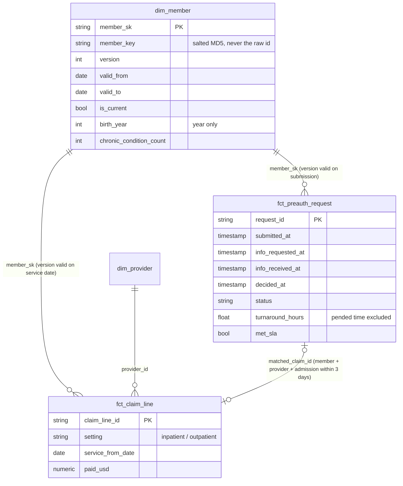
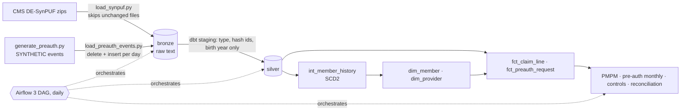

# Health Claims & Pre-Authorisation Warehouse

[](https://github.com/Saigwe/health-claims-warehouse/actions/workflows/ci.yml)

> A Kimball claims warehouse on 857,285 CMS DE-SynPUF claim lines ($863M paid) for 116,352 synthetic Medicare members. SCD Type 2 member history built from yearly files, with point-in-time joins. A pre-authorisation accumulating snapshot with clock-stop turnaround and claim matching. PMPM cost, control exceptions and an honest reconciliation to CMS's own totals. Salted-hash masking with an enforced policy test, and an idempotent Airflow 3 DAG. The same dbt project builds on DuckDB and Postgres.

**Author:** Stanley Igwe, Lead Data (Analytics) Engineer · [Portfolio](https://saigwe.github.io)
**Stack:** Python · DuckDB · Postgres 16 · dbt Core (unit tests, cross-database macros) · Apache Airflow 3.2 · pytest · GitHub Actions
**Status:** Core build complete on the full DE-SynPUF Sample 1. See [Roadmap](#roadmap).

Project 13 of my portfolio plan. At a Big Four firm I delivered a data warehouse and medical-operations dashboards for a health insurer, covering about 800k pre-authorisation requests and cost-benefit analysis. This repo rebuilds the problem on public synthetic data. No employer or client data, code or logic is used, and no real patient appears anywhere.

---

## 90-second summary
| | |
|---|---|
| **Problem** | Medical-operations teams need to know how fast pre-authorisations are decided, what members cost per month, and which admissions were paid without approval, without anyone seeing an identifiable member. |
| **What I built** | A star schema on CMS's synthetic Medicare claims. Member history is versioned (SCD2), so a 2009 claim carries the member's 2009 conditions. A pre-authorisation snapshot stops the clock while waiting for information and matches each request to its admission like a payer does. Reports cover PMPM by chronic-condition burden, turnaround against the CMS 72-hour / 7-day deadlines, and control exceptions. Identifiers are hashed at the first layer, and a test fails the build if one leaks. |
| **Why it matters** | One trusted cost and turnaround view; leakage found from the data, not from audit sampling; member privacy enforced by the pipeline instead of a policy document. |
| **Proof** | [Numbers](#numbers) from `make all` on the real files; CI runs the same code on DuckDB, Postgres and Airflow. |

## Star schema




## Data
- **Real:** [CMS DE-SynPUF](https://www.cms.gov/data-research/statistics-trends-and-reports/medicare-claims-synthetic-public-use-files) Sample 1: beneficiary summaries for 2008, 2009 and 2010 (343,644 member-years), 66,773 inpatient and 790,790 outpatient claim lines. Synthetic records made by CMS from real distributions; free to use, no sign-in.
- **Synthetic, generated here:** pre-authorisation events (DE-SynPUF has no pre-auth workflow). They are built on the real admissions with a fixed seed: 71,362 requests and 178,679 events. 95% of admissions are approved first, 2% denied yet paid, 3% have no request, plus denied, withdrawn and open requests with no admission. **So the control-exception totals below show that the logic finds what was planted. They are not a finding about Medicare.**

## Data model
| Model | Purpose |
|---|---|
| `stg_synpuf__*`, `stg_preauth__events` | Typed text, salted-hash member ids, birth year only, segment-2 claim lines inherit their claim's dates. |
| `int_member_history` | SCD2 versions: a new version only when a tracked attribute (conditions, ESRD, death, location) changes; unchanged years fold in. |
| `dim_member` | SCD2 with `valid_from` / `valid_to` / `is_current`. The first version covers earlier dates, so late-2007 claims (early-arriving facts) keep their member. |
| `fct_claim_line` | One row per claim segment, joined to the member version valid on the service date. |
| `fct_preauth_request` | Accumulating snapshot: one row per request with a column per milestone, turnaround excluding time pended for information, SLA flag, matched claim. |
| `rpt_cost_pmpm` | Paid per member per month by year and chronic-condition band (Part A months for inpatient, Part B for outpatient). |
| `rpt_preauth_monthly` | Requests, approval rate, pended share, median / p90 turnaround and SLA met, by month and priority. |
| `rpt_preauth_controls` | Admissions by authorisation outcome; anything not approved is an exception. |
| `rpt_claims_reconciliation` | Claims paid vs the beneficiary summary's reimbursement totals, by year and setting. |
| `qa_claim_lines_without_dates` | Quarantine for claim lines with no service date anywhere on the claim. |

## Tests
- **Reconciliation:** every claim line and cent in bronze reaches the fact or the quarantine table.
- **SCD2:** member versions never overlap or leave gaps, and exactly one is current. A unit test checks that unchanged years fold in and a change opens a version.
- **Point-in-time:** every claim's member version was valid on its service date.
- **Masking policy:** no silver or gold column looks like a raw id or birth date; every `member_key` is a 32-character hash; no raw id appears in gold. A pytest plants a leaking view and asserts the test fails.
- **Accumulating snapshot:** milestones are in order, and a decision exists exactly when a request is closed.
- **Idempotency:** re-loading a day changes nothing (pytest), and in CI, the Airflow DAG run twice for the same date leaves the same row counts.
- **Portability:** CI builds the whole project on DuckDB and on Postgres 16.

## Numbers
From `make all` on the real files, on a laptop.

| Metric | Value |
|---|---|
| Rows processed | 343,644 member-years; 857,563 claim lines; 178,679 synthetic pre-auth events |
| Bronze load | 9 s for all CMS files; 0 s when unchanged (hash check) |
| dbt build | 46 nodes (13 models, 32 data tests, 1 unit test) in 7.7 s |
| Member history | 116,352 members → 279,711 SCD2 versions; 87,289 members (75%) changed at least once |
| Paid per member per month (inpatient / outpatient) | 2008: $199.01 / $64.22 · 2009: $190.99 / $74.02 · 2010: $105.31 / $41.56 |
| Cost by burden (2008 inpatient PMPM) | $2.67 with no chronic conditions vs $759.42 with 5 or more |
| Pre-auth turnaround (synthetic) | urgent median 9.1 h (p90 21.5 h), standard median 29.9 h (p90 70.0 h); 25% pended; approval rate 91.4% |
| Within CMS deadlines (72 h / 7 days) | 99.9% urgent, 99.5% standard |
| Requests matched to admissions | 64,640 of 71,362 (the rest have no admission by design, or fall outside the 3-day window) |
| Control exceptions (planted) | 3,368 admissions, $32.3M paid without an approved pre-auth: 2,065 with no request ($19.8M) and 1,303 after a denial ($12.4M) |

**Data-quality findings on the CMS files** (`rpt_claims_reconciliation`, `qa_claim_lines_without_dates`):
- Inpatient claims match the summary file's reimbursement within 0.2% for 2008, but are 2.1% short for 2009 and 5.0% short for 2010. Outpatient claims run 5–8% above the summary every year. These are two separate CMS deliverables, so the warehouse reports the gap instead of forcing a match.
- 278 outpatient segment-2 lines ($392,320) belong to claims whose segment 1 is missing, so they have no service date. They're quarantined, counted and reconciled, but never shown as cost in a period.
- 594 claim lines ($3.1M) are dated November–December 2007, before the first enrolment file. They join the member's earliest version.

## Orchestration
`airflow/dags/health_claims_daily.py` (Airflow 3.2): `check_sources → load_claims_if_changed → load_preauth_events[ds] → dbt_build → publish_kpis`.
- **Idempotent:** the day's events are deleted and reinserted; claims reload only when the files' hashes change.
- **Retries:** 2 per task with exponential backoff, plus per-task timeouts.
- **SLA:** Airflow 3 replaced SLAs with Deadline Alerts. A run must finish within 2 hours of being queued, or `hcw_alerts.deadline_missed` fires (it logs, or posts to `HCW_ALERT_WEBHOOK`).
- **Backfill:** `airflow backfill create --dag-id health_claims_daily --from-date 2009-03-01 --to-date 2009-03-31`. Each day is self-contained, so any range is safe to rerun.
- CI imports the DAG, checks its policies, and runs it end to end on the fixture twice for the same day.

## How to run
Requires **Python 3.12** (what CI uses) and `make`, or run the commands in the `Makefile` by hand.
```bash
python -m venv .venv && source .venv/bin/activate   # Windows: .venv\Scripts\activate
pip install -r requirements.txt
make download && make all     # real CMS files (~49 MB): load, synthetic pre-auth, dbt build, tests
make fixture-all              # synthetic SynPUF-format files through the same code (CI)
make postgres-fixture         # the same dbt project on Postgres (set PGHOST, PGUSER, PGPASSWORD, PGDATABASE)
```
Set `PII_SALT` in any shared environment; the default salt is for local and CI runs only.

## Roadmap
- [x] Scaffold: fixture, staging with key tests, first marts, CI
- [x] Load DE-SynPUF Sample 1 into bronze (DuckDB locally; Postgres proven in CI)
- [x] Kimball star: `fct_claim_line`, `fct_preauth_request` (accumulating snapshot), `dim_member` (SCD2), `dim_provider`
- [x] Turnaround time, approval rate, cost per member per month, control exceptions, reconciliation to CMS totals
- [x] PII masking: birth year only, salted hashed identifiers, and an enforced masking policy test
- [x] Daily Airflow DAG with retries, a deadline alert (Airflow 3's SLA replacement), idempotent daily loads and backfill
- [x] Star-schema diagram in the README
- [ ] Metabase dashboard over the gold marts
- [ ] Carrier (physician) claims and Part D events from the same sample
- [ ] 3-minute Loom walkthrough

## Interview topics this project prepares
- Kimball modelling: SCD2 from snapshots, point-in-time joins, accumulating snapshots, early-arriving facts
- Healthcare metrics: PMPM, turnaround with clock-stop, prior-authorisation deadlines
- Privacy engineering: masking at the first layer, and tests that prove it
- Orchestration: idempotency, retries, backfills, SLAs in Airflow 3

## Data and licence
- **CMS DE-SynPUF:** synthetic public-use files from the Centers for Medicare & Medicaid Services; no real beneficiary is represented.
- **Synthetic pre-authorisation events and CI fixture:** generated with fixed seeds in this repo.
- **Code:** MIT (see `LICENSE`).
